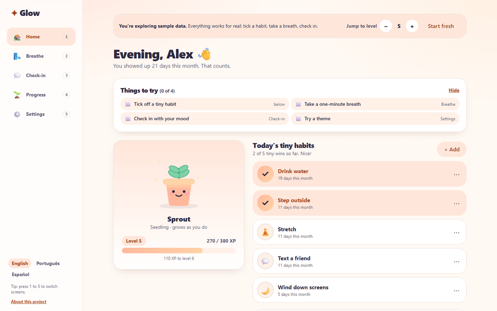
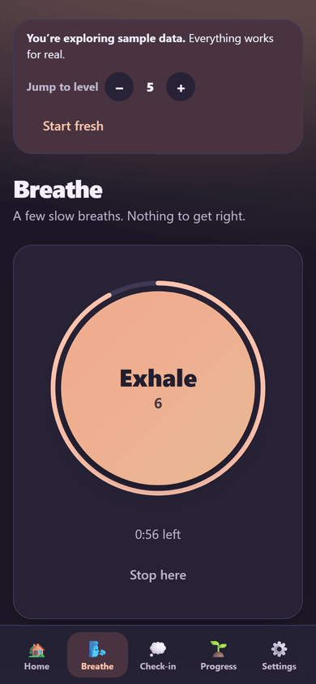
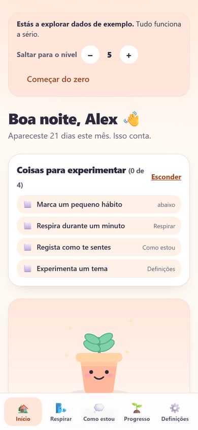

# Glow ✨

A gentle self-care web app. Tiny habits, breathing exercises and mood check-ins earn XP that grows a little plant companion and unlocks cosmetic themes. No streak penalties, no guilt, no account, no backend: everything stays in the browser.

**Live:** https://glow.franciscowebdev.com (installable, works offline, English / Português / Español)

**Stack:** React 19, TypeScript, Vite, Tailwind CSS v4, Framer Motion, vite-plugin-pwa, Vitest, Playwright.


| Computer | Phone (dark) | Portuguese |
| --- | --- | --- |
|  |  |  |

A longer narrated-by-captions tour (about 90 seconds, with title cards and camera moves) is in [`docs/media/glow-demo-full.mp4`](docs/media/glow-demo-full.mp4) (plays everywhere; a WebM copy is next to it). More in `docs/screenshots/`; a draft write-up for a project page is in `docs/CASE_STUDY.md`.

## For someone trying it

The first screen offers **Explore with sample data**: thirty days of believable history (habits, moods, breathing), so every screen is full straight away. A short "Things to try" list ticks itself off, a bar lets you jump to any level to see everything it unlocks, and **Start fresh** gives you your own empty copy. Locked themes can be previewed from Settings, and the companion at every level from Progress, without changing anything real. On a computer the number keys 1 to 5 switch screens.

The text follows the browser's language (English, Portuguese, Spanish), and the switcher is on the first screen and in Settings.

## Setup

Requires Node 20+.

```bash
npm install
npm run dev        # http://localhost:5173
```

| Command | What it does |
| --- | --- |
| `npm run dev` | Dev server with hot reload |
| `npm test` | Unit tests (XP curve, dates, breathing, actions, backup and sample data, reminders) |
| `npm run typecheck` | TypeScript check (also proves every language has every sentence) |
| `npm run build` | Typecheck + production build (generates the service worker; the PWA step takes about a minute) |
| `npm run preview` | Serve the production build. **Use this to test install and offline.** |
| `npm run test:e2e` | Browser tests in real Firefox and WebKit (see below) |
| `npm run icons` | Regenerate PWA icons in `public/` (dependency-free script) |

The service worker only runs in the production build. Run `npm run build && npm run preview`, open the app, then go offline and reload. It keeps working.

## Browser tests

`e2e/` opens the built app in **real Firefox and WebKit** (the engine behind Safari), on a computer-sized and a phone-sized window, and uses it like a visitor: sample data, ticking a habit, check-in, theme preview, download a backup, start over, restore it, a wrong file, a breathing session, offline use, keyboard shortcuts, the About box, and all three languages (no English left on a Portuguese or Spanish screen, nothing sticking out on a 320 px phone).

```bash
npx playwright install firefox webkit     # once per machine
npm run build
npm run test:e2e
BASE_URL=https://glow.franciscowebdev.com npm run test:e2e --workers=2    # against the live site
```

## Languages

All text lives in `src/i18n/` (`en.ts` is the source; `pt.ts` and `es.ts` must have exactly the same keys or the build fails). `{name}` markers are filled in by the code; keys ending `.one` / `.other` are singular and plural. The language is "automatic" (the browser's, with English as the fallback) or chosen by hand, and it is kept in the saved data and in backups. Dates use the language's own format. The sample data (habit names, little notes) is made in the chosen language. To add a language: copy `en.ts`, translate it, add it to `LANGUAGES` in `src/i18n/index.tsx`.

## Renaming the app

"Glow" is a placeholder. Change it in **`src/config/app.ts`** (`APP_NAME`, `APP_TAGLINE`, `STORAGE_KEY`, `SITE_URL`, the author). The page title, share preview, PWA manifest and UI all read from there. Changing `STORAGE_KEY` starts users with fresh data. The share picture is `public/og-image.png`.

## How it works

### XP and levels (`src/lib/xp.ts`)
- Rewards: habit **10**, breathing session **15**, daily check-in **10**.
- Level `n` → `n+1` costs `round(40 · n^1.4 / 5) · 5` XP (40, 105, 185, 280, …), so levels get gradually harder. At a typical 55 XP a day the last unlock (level 15) is about six months away.
- Level is always derived from total XP, never stored.
- Anti-farming without punishment: a habit gives XP once per day, and the check-in once per day. Unticking never removes XP. Skipped days cost nothing.

### Habits on their own days
A habit can be meant for some weekdays only (`days` on the habit, 0 = Sunday ... 6 = Saturday; nothing means every day). The Home screen lists the habits meant for today and tucks the others under "for another day"; they can still be ticked and still earn XP, so nothing is ever locked or scolded. Schedules are cleaned when loaded and when a backup is restored (`normalizeDays` in `src/lib/habits.ts`).

### Unlocks (`src/data/unlocks.ts`)
**After level 15 a garden grows** beside the companion: the first plant at level 16 and a new one every two levels, up to eight (level 30). The sample bar can jump that high to show it.

Six themes (Peach L1, Lavender L2, Mint L4, Sky L6, Rosé L9, Aurora L13), six companion growth stages (seed → in bloom) and five accessories (rosy cheeks, sparkles, bow, shades, crown) tied to levels.

### Data and storage
All data is one versioned JSON object under `STORAGE_KEY`, accessed through `src/lib/storage.ts` (`StorageAdapter`) and `src/state/persistence.ts`. Components never touch `localStorage`. To add a backend later, implement a new adapter or replace `persistence.ts` with an async repository. State transitions in `src/state/actions.ts` are pure functions, so they can be reused server-side.

**Backups.** Settings has *Download a backup* and *Restore a backup*. A restore is checked first (`parseBackup` refuses anything that is not clearly a Glow backup, and fills in settings an older backup does not have), then asks before replacing anything. After two weeks without a backup a gentle card suggests one; if the browser refuses to save anything (blocked site data) it says so. Once set up, the app asks the browser to keep its data (`navigator.storage.persist`). **Two copies open at once** (two tabs, or the browser and the installed app) stay in sync through the `storage` event.

**Sample data** (`src/lib/sample.ts`) is generated from a fixed seed, so it is the same every time, and its XP is exactly what the real rules would have granted. It is marked `sample: true`; "Start fresh" removes it. The language choice survives loading it, starting fresh, and a reset.

### Breathing
Five exercises: Box (4·4·4·4), 4-7-8, Calm (4·6), Coherent (5·5, about six breaths a minute) and Sigh (two quick sips of air, then one long breath out). A phase can say how big the circle is when it starts and ends (`from` / `to` in `src/lib/breathing.ts`), which is how the sigh's two in-breaths work.

The session clock only advances while the app is showing (`advanceElapsed` in `src/lib/breathing.ts`), so locking the phone pauses it instead of finishing it and awarding XP. The screen is kept awake during a session (Screen Wake Lock, `src/hooks/useWakeLock.ts`), and a soft vibration marks each phase on phones that support it (a setting).

### Reminders
Uses the Notification API (through the service worker when available). Permission is requested only when you tap the button. If notifications are denied or unsupported, reminders show as a soft in-app toast instead. **Limitation:** with no backend or push server, a reminder can only fire while the app is open or running in the background. A reminder that is more than 5 minutes late is skipped rather than nagging.

### Accessibility
Pastel palette with dark-ink text and strong accent colours for text (≥4.5:1). Honors `prefers-reduced-motion`. Keyboard-focusable controls, labelled radios and switches, dialog focus handling, a main landmark on every screen. The automated accessibility check (axe) reports no violations on any screen, in light and dark, on phone and computer, in all three languages.

### Speed
Only the home screen and the app shell are in the first download (about 80 KB compressed); the other screens and the animation code load right after, and are saved for offline use. Lighthouse on the live site (mobile, simulated slow 4G): performance 94, accessibility, best practices and SEO 100; first paint 1.5 s, no layout shift, 160 KB transferred.

## Project layout

```
src/
  config/      app name, address, author
  i18n/        the text in three languages, and the small translation helper
  lib/         pure logic + tests (xp, dates, breathing, stats, backup, sample data, reminders, storage)
  data/        unlocks, habit ideas, moods (the words are in i18n/)
  state/       data model, pure actions, persistence, React contexts
  hooks/       theme, router, shortcuts, reminder scheduler, wake lock, today
  components/  small typed UI pieces (ui/ holds primitives)
  screens/     Home, Breathe, CheckIn, Progress, Settings, Onboarding
e2e/           browser tests (Playwright)
public/        icons, share picture, robots.txt, .htaccess for the server
```

## Putting it online (Hostinger, as a subdomain)

Glow is a static site: there is nothing to run on the server.

1. In hPanel create the subdomain (for example `glow.franciscowebdev.com`) with its own folder. It has to be the **root** of a (sub)domain, because the install manifest uses `/` as its start address.
2. `npm run build`.
3. Upload the **contents** of `dist/` (not the folder itself) to that subdomain's folder. `dist/.htaccess` comes from `public/.htaccess`: it keeps `index.html` and `sw.js` from being cached for long (so an update reaches visitors), caches the hashed files in `assets/` for a year, sends security headers, and a strict Content-Security-Policy whose one hash (for the tiny inline theme script) the build fills in itself.
4. Open the address once. On Android in Chrome use **⋮ → Install app**; on a computer, the install icon in the address bar. Long-press the icon on Android for the *Breathe* and *Check in* shortcuts.

To update later: build, upload `dist/` again. The app updates itself the next time it opens. A first visit takes a few seconds to save everything for offline use.

Your data lives in the browser or app it was created in. The website tab and the installed app on one phone share it; a second device starts empty until you restore a backup there.
